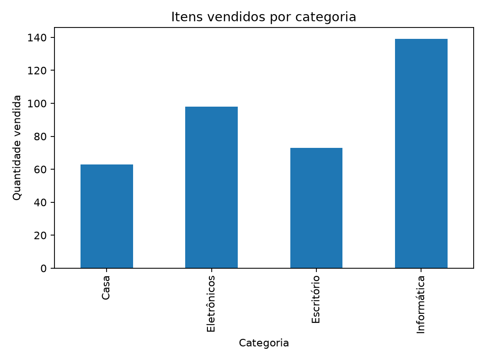
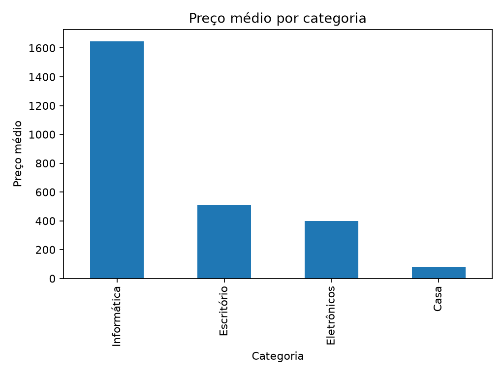

# Análise exploratória de produtos

Projeto de análise exploratória reproduzível, desenvolvido para transformar uma
base simples de produtos em métricas, visualizações e perguntas de negócio.

## Objetivo

Investigar a relação entre preço, categoria e volume vendido, identificando
padrões úteis antes de construir um dashboard ou um modelo preditivo.

## Perguntas analisadas

- Quais categorias concentram mais vendas?
- Qual é o preço médio e mediano da base?
- Qual produto possui o maior preço?
- Como os preços médios variam entre categorias?
- Existem valores ausentes na base?

## O que o projeto entrega

- resumo estatístico em JSON;
- preço médio, mediano e desvio padrão;
- total de itens vendidos;
- categoria com maior volume vendido;
- preço médio por categoria;
- gráfico de vendas por categoria;
- gráfico de preço médio por categoria;
- testes automatizados das principais funções.

## Tecnologias

- Python 3.11+
- Pandas
- Matplotlib
- Pytest

## Como executar

```bash
python -m venv .venv
.\.venv\Scripts\activate
pip install -r requirements.txt
python analysis.py
```

Os arquivos são gerados em:

```text
outputs/summary.json
outputs/figures/vendas_por_categoria.png
outputs/figures/preco_medio_por_categoria.png
```

## Como executar os testes

```bash
pytest -q
```

## Estrutura

```text
analysis.py                 # pipeline principal da análise
data/products.csv           # base de demonstração
outputs/                    # resultados gerados
tests/test_eda_analysis.py  # testes das métricas
docs/images/                # imagens para documentação
```

## Exemplos de leitura

O resumo atual possui 8 produtos distribuídos em 4 categorias. A categoria
Informática concentra o maior volume vendido, enquanto o Notebook Pro é o
produto de maior preço. Essas conclusões são descritivas: elas não provam que o
preço causou maior ou menor volume de vendas.

## Visualizações

### Vendas por categoria



### Preço médio por categoria



## Aprendizados

Este projeto reforça que uma análise começa pela definição das perguntas e pela
validação da base. A média sozinha pode esconder diferenças entre grupos; por
isso, o projeto também calcula mediana, dispersão e comparações por categoria.

## Status

Projeto preparado para estudo e publicação. O deploy público será definido
depois da revisão da análise e da criação do repositório independente.
